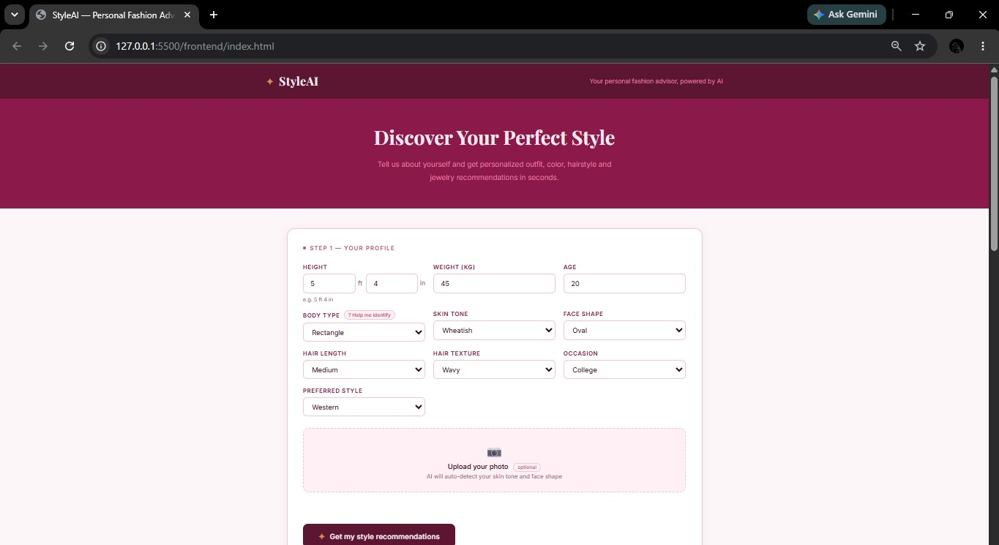
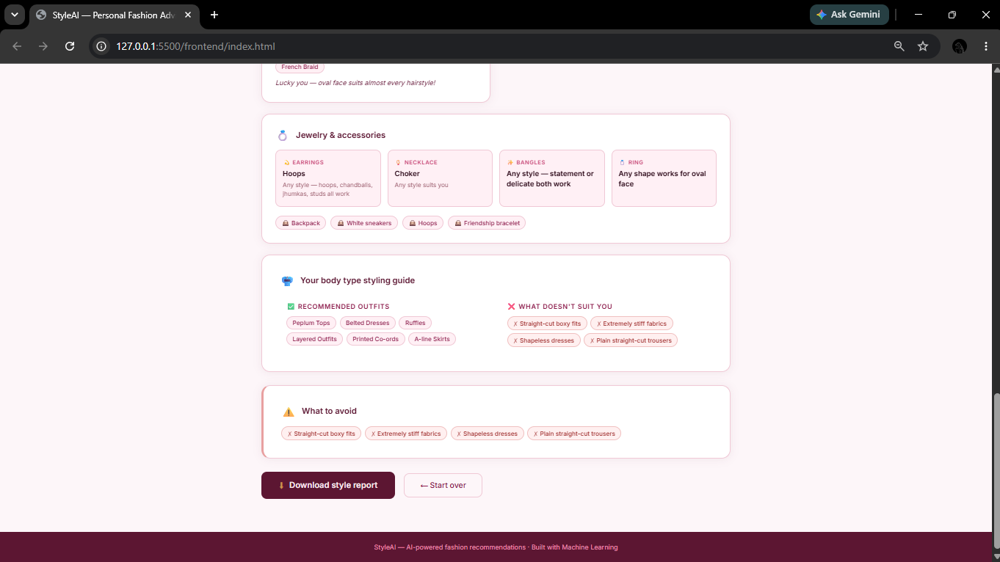

# Style-AI ✨

### Profile-Based Personalized Fashion Styling System

Style-AI provides outfit, color palette, hairstyle, jewelry, and accessory suggestions based on profile selections such as body type, skin tone, face shape, occasion, and fashion preferences.

The Flask recommendation API uses Scikit-learn decision trees trained on a generated prototype dataset. The examples are derived from curated styling rules, not real user outcomes, so they demonstrate the ML workflow but do not establish real-world prediction accuracy.

---

## 🚀 Features

### Personalized Fashion Recommendations

* Outfit Recommendations
* Color Palette Suggestions
* Hairstyle Recommendations
* Jewelry Recommendations
* Accessory Suggestions

### User Profile Analysis

* Height & Weight Analysis
* Body Type Selection
* Skin Tone Selection
* Face Shape Selection
* Occasion Selection
* Fashion Style Preferences

### Recommendation Categories

* Casual Wear
* College Wear
* Office Wear
* Party Wear
* Wedding Wear
* Traditional Wear
* Indo-Western Wear

---

## 🤖 Current Recommendation Model

The app trains separate Scikit-learn decision-tree classifiers to produce outfit, color-palette, hairstyle, earring, necklace, and accessory suggestions. The generated training CSV contains all 18,000 combinations of the supported profile categories:

* Body Type
* Skin Tone
* Face Shape
* Occasion
* Preferred Fashion Style
* Hair length and texture

The CSV is generated by `backend/data/generate_training_data.py`. The generated labels come from the project’s curated style catalog; replace them with reviewed, labeled recommendations or user feedback before claiming real-world accuracy. Age, height, and weight are currently used for profile validation and BMI display, not as model features.

---

## 🛠️ Technology Stack

### Frontend

* HTML5
* CSS3
* JavaScript

### Backend

* Flask

### Database

* MongoDB Atlas persistence is available with explicit user opt-in

### Image Analysis

* Python
* OpenCV
* Pillow

### Machine Learning

* Scikit-learn
* DecisionTreeClassifier

### Development Tools

* VS Code
* Git
* GitHub

## ▶️ Run the application locally

The Flask server serves both the frontend and API. From the repository root in PowerShell:

```powershell
py -3.11 -m venv backend\.venv
.\backend\.venv\Scripts\Activate.ps1
pip install -r backend\requirements.txt
Copy-Item .env.example .env
# Edit .env and set MONGO_URI to your Atlas connection string.
python backend\app.py
```

Open [http://127.0.0.1:8000/](http://127.0.0.1:8000/). Do not open `frontend/index.html` directly or use a separate static server; the frontend calls the Flask API at the same origin.

MongoDB saving is optional. The profile form has an unchecked consent box; no profile data is stored unless a user checks it. Uploaded photos are not sent to MongoDB. Keep the real Atlas URI only in the ignored local `.env`, never in source control.
This project does not yet include account authentication; add access controls before deploying saved profile data to a public service.

If port 8000 is already in use, set a free port before starting Flask:

```powershell
$env:PORT = "8001"
python backend\app.py
```

Then open [http://127.0.0.1:8001/](http://127.0.0.1:8001/).

Run backend tests with:

```powershell
python -m pytest -q backend\test_app.py
```

### Current backend scope

- `GET /api/health` checks that the Flask server is responding.
- `POST /api/recommend` validates the profile and returns Scikit-learn prototype predictions trained on the generated dataset. The labels are synthetic and not validated real-world outcomes.
- `POST /api/upload` validates and stores JPG, PNG, and WEBP images, then uses OpenCV for face detection and skin-tone estimation when one face is found. Face shape remains a manual selection.
- `GET /api/uploads/<filename>` serves a previously uploaded image.
- When a user opts in, `POST /api/recommend` stores the profile and generated recommendation in the `recommendation_history` MongoDB collection.
- `python test_db.py` checks Atlas connectivity and reports missing or invalid configuration without printing credentials.

Images are limited to 10 MB and stored under `backend/uploads/`. MongoDB is not required to generate recommendations, but an Atlas connection is required to persist them.

---

## 📸 Screenshots

### User Profile Page and Outputs

## Project Demo

<h2>📸 Screenshots</h2>

<h3>1. User Profile Input</h3>


<h3>2. User Data Analysis</h3>


<h3>3. Fashion Recommendations Output</h3>


<h3>4. Styling Suggestions & Results</h3>


> Screenshots will be updated as new modules are completed.

---

## 🚧 Development Status

Style-AI is in development. Its current Scikit-learn model is trained on generated prototype labels and has not been validated against real user outcomes.

### Completed Modules

✅ Profile form with manual body, skin-tone, and face-shape selection

✅ Flask server for the frontend and API

✅ Profile validation and rule-based styling recommendation API

✅ Image upload validation, OpenCV preprocessing, face detection, and basic skin-tone estimation

✅ Scikit-learn recommendation prototype trained on generated style examples

### In Progress

🔄 Real labeled data for ML evaluation, Atlas credentials/connectivity verification, and improving skin-tone reliability

### Upcoming Features

📌 Face Shape Detection from Images

📌 AI-Powered Image Upload Analysis

📌 Virtual Fashion Try-On

📌 Deep Learning-Based Recommendations

📌 Fashion Trend Prediction

---

## 🎯 Project Objectives

* Provide personalized fashion recommendations from user-selected profile information.
* Improve styling decisions through data-driven suggestions.
* Recommend outfits based on body type and occasion.
* Suggest colors suitable for different skin tones.
* Recommend hairstyles according to face shape.
* Provide matching jewelry and accessory recommendations.
* Build an intelligent fashion assistant for women.

---

## 📈 Future Enhancements

* Computer Vision Integration using OpenCV
* Facial Feature Detection
* Automated User Attribute Extraction
* Deep Learning Recommendation Models
* Mobile Application Development
* Fashion E-Commerce Integration
* Personalized Shopping Assistant

---

## 👨‍💻 Developer

**Heer Sagaria**

B.Tech Computer Science & Engineering

Machine Learning & Data Analytics Enthusiast

---

## ⭐ Project Category

**Machine Learning | Recommendation System | Data Analytics | Full-Stack Development**
