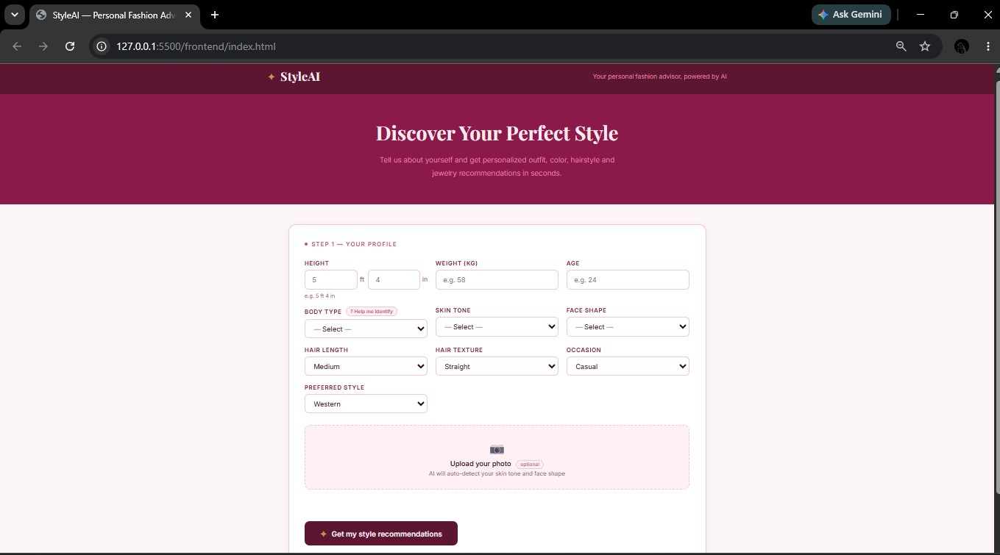
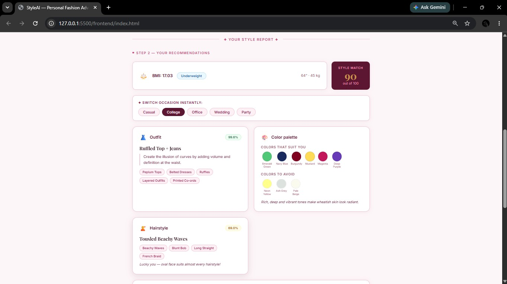

# Style-AI ✨

### Profile-Based Personalized Fashion Styling System

Style-AI provides photo-only color and face-related suggestions from detected skin tone and face shape. The full outfit recommendation workflow can additionally use profile selections such as body type, occasion, and fashion preferences.

The Flask recommendation API uses a small Scikit-learn multilayer perceptron trained on a generated prototype dataset. The labels come from curated styling rules, not real user outcomes, so this is an experimental neural-network pipeline and does not establish real-world recommendation accuracy.

---

## 🚀 Features

### Personalized Fashion Recommendations

* Outfit Recommendations
* Color Palette Suggestions
* Hairstyle Recommendations
* Jewelry Recommendations
* Accessory Suggestions

### User Profile Analysis

* Height & Weight Analysis
* Body Type Selection
* Skin Tone Selection
* Face Shape Selection
* Occasion Selection
* Fashion Style Preferences
* Optional face-landmark estimate with manual correction
* Photo-only color palette, hairstyle, and jewelry suggestions when skin tone or face shape is detected
* Optional browser camera capture, with explicit permission, for the same photo-analysis flow

### Recommendation Categories

* Casual Wear
* College Wear
* Office Wear
* Party Wear
* Wedding Wear
* Traditional Wear
* Indo-Western Wear

---

## 🤖 Current Recommendation Model

The app trains separate Scikit-learn `MLPClassifier` models (48 and 24 hidden units) to produce outfit, color-palette, hairstyle, earring, necklace, and accessory suggestions. The generated training CSV contains 18,000 combinations of the supported profile categories:

* Body Type
* Skin Tone
* Face Shape
* Occasion
* Preferred Fashion Style
* Hair length and texture

The CSV is generated by `backend/data/generate_training_data.py`. The generated labels come from the project’s curated style catalog; the neural network only learns those rules. Replace them with reviewed, labeled recommendations or consented user outcomes and evaluate on held-out data before claiming real-world accuracy. Age, height, and weight are used for profile validation and BMI display, not as model features.

The recommendation card lets users give a 1–5 match rating. This is self-reported feedback for the current result, not measured model accuracy, and it is not used to train the model.

---

## 🛠️ Technology Stack

### Frontend

* HTML5
* CSS3
* JavaScript

### Backend

* Flask

### Database

* Local MongoDB or MongoDB Atlas persistence with explicit user opt-in

### Image Analysis

* Python
* OpenCV
* MediaPipe Face Mesh
* Pillow

### Machine Learning

* Scikit-learn
* MLPClassifier (experimental)

### Development Tools

* VS Code
* Git
* GitHub

## ▶️ Run the application locally

The Flask server serves both the frontend and API. From the repository root in PowerShell:

```powershell
py -3.11 -m venv backend\.venv
.\backend\.venv\Scripts\python.exe -m pip install -r backend\requirements.txt
if (-not (Test-Path .env)) { Copy-Item .env.example .env }
# Local MongoDB is optional; install/start MongoDB Community Server to use the sample URI.
.\backend\.venv\Scripts\python.exe backend\app.py
```

VS Code uses `backend\.venv\Scripts\python.exe` as the workspace interpreter after the environment is created.

Open [http://127.0.0.1:8000/](http://127.0.0.1:8000/). Do not open `frontend/index.html` directly or use a separate static server; the frontend calls the Flask API at the same origin.

MongoDB saving is optional. The profile form has an unchecked consent box; no profile data is stored unless a user checks it. The sample `.env.example` uses local MongoDB at `127.0.0.1:27017`; start MongoDB locally before opting in to persistence. For Atlas, replace `MONGO_URI` with your Atlas URI in the ignored local `.env`. Never put credentials in source control.
Use **Use camera** to request browser permission and capture a photo, or upload one. Camera access requires localhost or HTTPS and is requested only after the button is clicked. Face analysis estimates facial features and does not identify a person. Uploaded photos are not sent to MongoDB; Flask stores them under `backend/uploads/` for analysis. The app has no user accounts or authentication, so do not deploy it publicly with profile saving enabled without adding access controls.

If port 8000 is already in use, set a free port before starting Flask:

```powershell
$env:PORT = "8001"
.\backend\.venv\Scripts\python.exe backend\app.py
```

Then open [http://127.0.0.1:8001/](http://127.0.0.1:8001/).

Run backend tests with:

```powershell
.\backend\.venv\Scripts\python.exe -m pytest -q backend
```

### Current backend scope

- `GET /api/health` checks that the Flask server is responding.
- `POST /api/recommend` validates the profile and returns experimental neural-network recommendations trained on the generated dataset. The labels are synthetic and not validated real-world outcomes.
- `POST /api/upload` validates and stores JPG, PNG, and WEBP images, then uses OpenCV for face detection/skin-tone estimation and MediaPipe Face Mesh for an approximate face-shape estimate. It returns photo-only color and face-related suggestions when these features are detected; body type, occasion, and clothing fit are not inferred from the image.
- `GET /api/uploads/<filename>` serves a previously uploaded image.
- When a user opts in, `POST /api/recommend` stores the profile and generated recommendation in the `recommendation_history` MongoDB collection.
- `backend\.venv\Scripts\python.exe test_db.py` checks configured MongoDB connectivity and reports missing or invalid configuration without printing credentials.

Images are limited to 10 MB and stored under `backend/uploads/`. MongoDB is not required to generate recommendations, but a running local MongoDB or reachable Atlas cluster is required to persist them.

---

## 📸 Screenshots

### User Profile Page and Outputs

## Project Demo

<h2>📸 Screenshots</h2>

<h3>1. User Profile Input</h3>


<h3>2. User Data Analysis</h3>


<h3>3. Fashion Recommendations Output</h3>


<h3>4. Styling Suggestions & Results</h3>


> Screenshots will be updated as new modules are completed.

---

## 🚧 Development Status

Style-AI is in development. Its experimental neural network is trained on generated prototype labels and has not been validated against real user outcomes. Face-shape output is a heuristic from facial proportions and should be manually checked.

### Completed Modules

✅ Profile form with manual body, skin-tone, and face-shape selection

✅ Flask server for the frontend and API

✅ Profile validation and rule-based styling recommendation API

✅ Image upload validation, OpenCV preprocessing, face detection, and basic skin-tone estimation

✅ MediaPipe face landmarks with an approximate, manually editable face-shape estimate

✅ Photo-only color and face-related style suggestions

✅ Experimental multilayer perceptron recommendation prototype trained on generated labels

### In Progress

🔄 Reviewed/real labeled data for model evaluation and improving computer-vision reliability

---

## 🎯 Project Objectives

* Provide personalized fashion recommendations from user-selected profile information.
* Improve styling decisions through data-driven suggestions.
* Recommend outfits based on body type and occasion.
* Suggest colors suitable for different skin tones.
* Recommend hairstyles according to face shape.
* Provide matching jewelry and accessory recommendations.
* Build an intelligent fashion assistant for women.

---

## 📈 Future Enhancements

* Real-world recommendation labels and offline model evaluation
* Fit-aware or generative virtual try-on
* Authenticated user profiles and deployment hardening
* Mobile Application Development
* Personalized Shopping Assistant

---

## 👨‍💻 Developer

**Heer Sagaria**

B.Tech Computer Science & Engineering

Machine Learning & Data Analytics Enthusiast

---

## ⭐ Project Category

**Machine Learning | Recommendation System | Data Analytics | Full-Stack Development**
